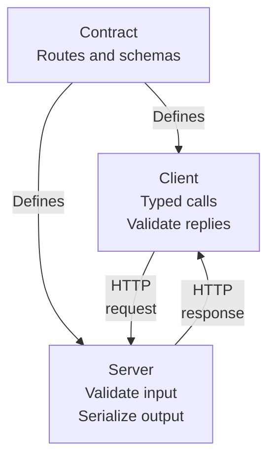

# skeld documentation

Build a service around one contract. Use it to validate incoming data, constrain outgoing data, and type the client that calls it.

If you are new to skeld, start with [your first request](guides/first-request.md). You will run a server and client, send an invalid request, and see exactly where the contract takes effect. The examples work from this checkout without an npm publication or an external service.

## Learn the model

The contract supplies both sides. HTTP still crosses a trust boundary: server validation protects the handler, and client validation checks responses for declared statuses. Sharing TypeScript types alone would establish neither property.

Read these in order, or jump to the task you are working on:

| Guide                                                           | What you will be able to do                                                            |
| --------------------------------------------------------------- | -------------------------------------------------------------------------------------- |
| [Your first request](guides/first-request.md)                   | Run the hello service and distinguish validation from application behavior             |
| [Design a contract](guides/contracts.md)                        | Choose bounds, response fields, and explicit application outcomes                      |
| [Call a service and handle errors](guides/client-and-errors.md) | Narrow responses by status and separate HTTP outcomes from failed calls                |
| [Organize a service](guides/plugins-and-lifecycle.md)           | Give a feature its own routes, hooks, state, and cleanup                               |
| [Classify data](guides/classification.md)                       | Keep secret and personal values out of schema-aware logs and control response exposure |
| [Connect a browser](guides/browser-security.md)                 | Configure CORS, cross-site checks, cookies, and redirects together                     |
| [Run a service](guides/running-a-service.md)                    | Set the public origin, proxy trust, timeouts, logging, and shutdown behavior           |
| [Troubleshoot](guides/troubleshooting.md)                       | Diagnose startup failures, refused requests, missing logs, and invalid responses       |

These explanations connect the guides: [the request lifecycle](concepts/request-lifecycle.md) shows when each stage runs; [security boundaries](concepts/security-boundaries.md) names what skeld enforces and what the application must supply. The [core threat model](concepts/threat-model.md) maps actors, data flows and trust boundaries to STRIDE threats, controls and residual responsibilities.

## Look up a detail

- [API reference](api/README.md): signatures and rules generated from the public source documentation.
- [Logging](logging/logging.md): options, delivery behavior, and limits; [record format](logging/record-format.md), [events](logging/events.md), [error disclosure](logging/errors.md), and [Collector ingestion](logging/collector.md).
- [Runnable examples](../examples/README.md): hello, classified logging, and a scoped task service.
- [Package README](../packages/core/README.md): installation, runtime requirements, and a compact feature reference.

To improve skeld or its documentation, see the repository's [contribution guide](../CONTRIBUTING.md).
