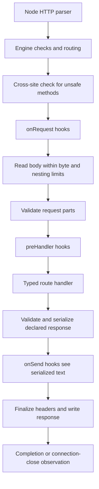

# The request lifecycle

Use this map to decide where a check belongs and which observations are possible. It describes a normal routed request with a schema-backed JSON response. Refusals and early replies can end it sooner.

Validation happens before a normal handler receives input. Serialization happens before `onSend` sees the JSON text. A hook's return value does not replace that serialized text.

## Where the normal path stops

| Condition                                                      | Consequence                                                                          |
| -------------------------------------------------------------- | ------------------------------------------------------------------------------------ |
| Node rejects HTTP framing before the engine receives a request | Node owns the response; engine headers and records are not universally available     |
| No route matches                                               | Framework 404; no route handler                                                      |
| CORS preflight                                                 | Handled before route hooks; it does not run the route handler                        |
| Cross-site check refuses                                       | Fixed 403 before application hooks or error handlers                                 |
| Body or schema refusal                                         | Framework error response before the handler                                          |
| Hook sends an early reply                                      | Normal downstream processing stops                                                   |
| Handler returns an undeclared status or mismatched body        | Engine failure response; arbitrary body data is not serialized as a successful reply |
| Handler throws                                                 | Error handling path; arbitrary thrown text does not become the public 500 body       |
| Request deadline expires                                       | 503, signal abort, no new error hook or error handler started, late result discarded |
| Client aborts                                                  | No guarantee a response can be delivered                                             |

Some checks span stages. For example, a declared oversized body can condemn the connection before `onRequest`; body reading enforces the actual byte limit as data arrives. The diagram is an ordering guide, not a promise that every invalid request reaches the same hook.

## Completion is an observation, not delivery proof

`onResponse` is for observing the response's completion or connection closure. It cannot edit the response and is not a universal observer for every refusal. An early `send()` skips it; the cross-site refusal path runs before its observers attach.

A write finishing does not prove the client consumed the body. The same distinction applies to log delivery: the process can know a write completed without knowing what another process retained.

## The deadline covers more than the handler

`handlerTimeoutMs` starts at route match. It includes asynchronous hooks, waiting for the body, validation and response work, not just the function registered as the handler. Timer scheduling still depends on the event loop being able to run.

Once time has expired, continuing application work must cooperate with `request.signal`. A late database write can still happen if its API ignores cancellation. Design side effects and retries with that possibility in mind.

Continue with [hooks and resource ownership](../guides/plugins-and-lifecycle.md) or [client-visible errors](../guides/client-and-errors.md).
