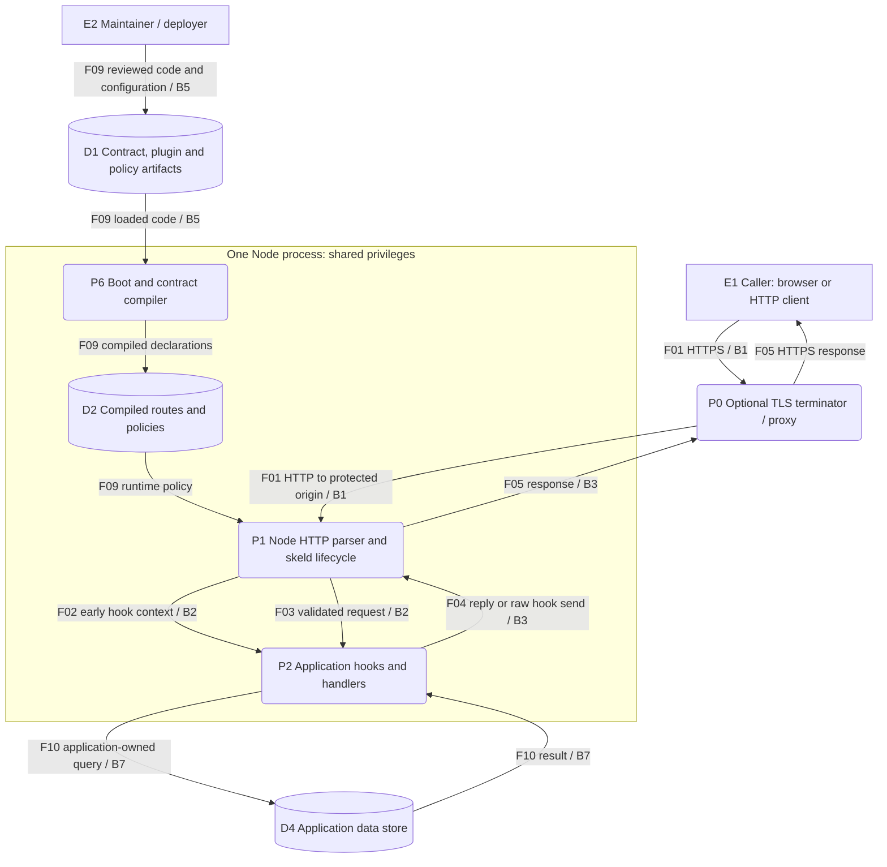
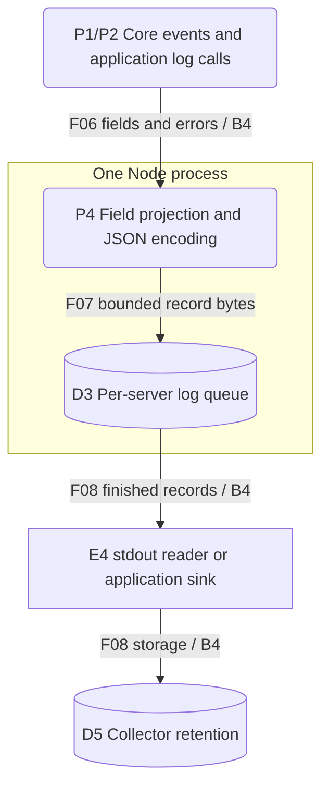
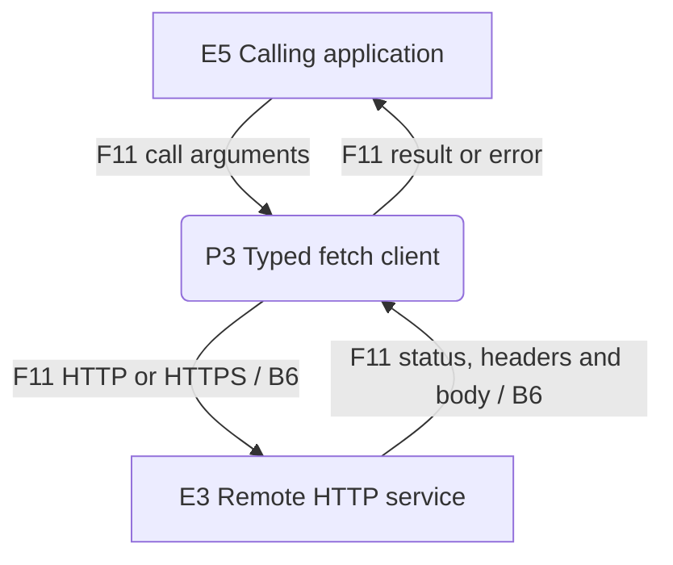

# Core threat model

This model describes the threats at skeld's framework boundaries, the controls implemented in core, and the work a service still owns. It uses STRIDE to examine specific actors, processes, stores and data flows. A schema-valid request is not an authorized request.

Reviewed on November 13, 2026 against source revision `80e9731`, with `@skeld/core` version `0.0.2`. This is a source-backed engineering assessment, not a certification, independent penetration test or security guarantee for applications built with skeld.

## Scope and assumptions

The scope includes the Node HTTP/1.1 server, contract compilation, request validation, response serialization, browser policies, the typed fetch client, structured logging, and startup and shutdown. Authentication is the next module; core does not currently provide accounts, sessions, authorization or tenant isolation.

The model assumes:

- Remote callers control request bytes, paths, headers and bodies, within what the transport accepts. A hostile browser origin can induce requests subject to browser restrictions. Non-browser callers can forge origin and forwarding headers.
- An upstream service can return an unexpected status, malicious payload, redirect or response that never completes.
- Application code, plugins, schema declarations, custom fetch implementations and log sinks are trusted executable code. They can still contain mistakes. skeld does not isolate them from the process, its credentials or its data.
- Node, the operating system and the installed framework are trusted dependencies. A compromised maintainer, package, runtime or host defeats that assumption and needs controls outside this library.
- TLS, reverse proxies, ingress restrictions, aggregate traffic limits, databases and log retention belong to the deployment. An optional proxy must preserve HTTP framing and sanitize forwarding headers. The proxy-to-core hop needs its own network protection.

The website, npm/GitHub account security, a particular application's business rules, and a future authentication module need separate models. Their interfaces are included here where they affect core; their protections are not claimed as implemented by core. The development diagnostic recorder is excluded from the published package and is not the production logger.

## Assets and adversaries

| Asset                        | What must be preserved                                                                |
| ---------------------------- | ------------------------------------------------------------------------------------- |
| A1: sensitive values         | Confidentiality of secrets and personal data in responses, errors, logs and transport |
| A2: application authority    | Integrity of account, tenant and resource decisions and state changes                 |
| A3: contract and wire data   | Agreement between declared operations, accepted requests and serialized responses     |
| A4: service resources        | Availability of CPU, memory, sockets, event-loop time and downstream capacity         |
| A5: operational evidence     | Useful, attributable records with known delivery and retention limits                 |
| A6: executable configuration | Integrity of contracts, plugins, policies, runtime and release artifacts              |

The adversaries are unauthenticated network callers, authenticated but unauthorized application users, hostile browser origins, malicious or faulty upstream services, and parties able to alter a trusted dependency or deployment. Operator and application mistakes can create the same paths without a malicious actor.

## System and data flows

Rectangles represent external entities, rounded boxes represent processes, and cylinders represent stores. Grouping shows ownership or execution context. The boundary labels on flows identify changes in trust or disclosure policy; a group inside the Node process is not a sandbox.

### Service request and boot path

Without a proxy, the caller connects directly to core's HTTP listener. Core binds loopback by default. The diagram does not imply that core terminates TLS, that every caller uses HTTPS, or that the illustrated data store is part of skeld.

F02 matters: `onRequest` runs before body reading and schema validation. F03 reaches `preHandler` and the normal handler after validation. Early hook replies use a raw payload path. A declared oversized body is marked for connection refusal before asynchronous `onRequest` work can admit later pipelined requests; an oversized streamed body is discovered during reading.

### Logging path

D3 is volatile and bounded. D5 is outside the library. Completing a write or sink call does not establish durable retention or that a human can retrieve a record. A custom sink executes in the application process even though its destination is outside the logger's ownership.

### Typed client path

The client builds calls from a trusted contract. It validates response bodies for declared statuses with a response schema. Undeclared statuses do not gain a schema merely because the caller uses TypeScript. The client never follows a redirect: a 301, 302, 303, 307 or 308 answer rejects the call. Fetch and transport security remain part of the trust boundary.

## Trust boundaries

| Boundary | Transition                                                         | Security consequence                                                                                           |
| -------- | ------------------------------------------------------------------ | -------------------------------------------------------------------------------------------------------------- |
| B1       | Remote network and optional proxy to core's socket                 | Framing, resource limits, TLS termination and proxy trust must agree across hops                               |
| B2       | Request bytes and early context to validated application input     | Shape checks precede normal handlers; early hooks must handle their own unvalidated inputs                     |
| B3       | Application values and errors to a public response                 | Declared serialization reduces accidental disclosure; raw replies and explicit exposure remain author choices  |
| B4       | Application data to encoded records, collectors and retained logs  | Classification, encoding and queue limits end before collector access control and retention                    |
| B5       | Source artifacts and configuration to compiled executable behavior | Only trusted declarations enter compilation; plugins have process privileges                                   |
| B6       | Remote HTTP response to the calling application's values           | A typed signature does not authenticate the endpoint or bound response time                                    |
| B7       | Application code to its data store or downstream service           | Resource authorization, query safety, transactions and dependency credentials are application responsibilities |

## How STRIDE is applied

STRIDE identifies threat classes: **Spoofing** identity, **Tampering** with data or behavior, **Repudiation** of actions, **Information disclosure**, **Denial of service**, and **Elevation of privilege**. It is an enumeration method, not a risk score.

This assessment uses STRIDE per element, then checks complete attack paths across boundaries. External entities are reviewed for spoofing and repudiation; processes for all six classes; flows for tampering, disclosure and denial of service; stores for tampering, disclosure and denial of service, with repudiation added where provenance or evidence matters. Other classes are considered at the process or endpoint that owns the relevant authority. This avoids treating an arrow itself as an identity or permission system.

### Element coverage

| Elements reviewed                                     | STRIDE questions applied                        | Threat records                                              |
| ----------------------------------------------------- | ----------------------------------------------- | ----------------------------------------------------------- |
| E1 callers; E3 remote service; E5 calling application | S, R; hostile payloads followed into processing | S1, S3, T4, T5, R1, I5, D4, E1                              |
| E2 maintainer; E4 collector/operator                  | S, R; compromise followed into code and storage | T3, R1, R2, I3, I5, D3, D5, E2                              |
| P0 deployment edge                                    | All six; controls owned by deployment           | S2, T1, R1, I5, D1, E1                                      |
| P1 HTTP lifecycle; P2 hooks/handlers                  | All six                                         | S1–S3, T1, T2, T4, T6, R1, R2, I1, I2, I4–I6, D1, D2, E1–E3 |
| P3 typed client                                       | All six                                         | S1, T5, R1, I2, I5, I6, D4, E3                              |
| P4 logger                                             | All six                                         | S3, R1, R2, I3, D3, E2                                      |
| P6 boot/compiler                                      | All six                                         | T3, R1, I2, D5, E2                                          |
| D1 artifacts; D2 compiled declarations                | T, I, D; R for provenance of changes            | T3, R1, I2, D5, E2                                          |
| D3 volatile queue; D5 retained logs                   | T, I, D, R                                      | R1, R2, I3, D3, E2                                          |
| D4 application store                                  | T, I, D, R at the application interface         | S1, R1, I1, D2, E1, E3                                      |
| F01/F05 network request and response                  | T, I, D                                         | T1, T2, T4, T6, I1, I2, I4–I6, D1                           |
| F02/F03/F04 hook, handler and reply paths             | T, I, D                                         | T2, I1, I2, D2, E1–E3                                       |
| F06/F07/F08 logging and delivery                      | T, I, D; R at evidence endpoints                | R1, R2, I3, D3                                              |
| F09 artifacts and compiled routes                     | T, I, D                                         | T3, I2, D5, E2                                              |
| F10 application dependencies                          | T, I, D                                         | I1, I5, D2, E1, E3                                          |
| F11 client call and upstream response                 | T, I, D                                         | T5, I2, I5, I6, D4, E3                                      |

There is no separate privilege boundary between P1, P2, P4 and P6: they share a process. Store and flow spoofing/elevation questions are evaluated through their accessing processes. The optional proxy and external stores are represented to expose required deployment controls; they have not been audited here.

## Threat register

Each record names a feasible path, current treatment and residual responsibility. “Mitigated” means a mechanism exists for the stated path, not that the threat is impossible. “Required” identifies a control the application or deployment must supply. The evidence references point to the implementation and regression coverage below.

### Spoofing

| ID and attack path                                                                                    | Current treatment                                                                                                                                       | Residual responsibility and evidence                                                                                                                            |
| ----------------------------------------------------------------------------------------------------- | ------------------------------------------------------------------------------------------------------------------------------------------------------- | --------------------------------------------------------------------------------------------------------------------------------------------------------------- |
| S1: a caller sends a well-formed request while impersonating an account or webhook sender (A2; B2/B7) | **Application control required.** Core checks shape and browser origin evidence; it does not authenticate callers.                                      | Authenticate credentials, verify webhook signatures and authorize each operation. Cookies, CORS and valid schemas are not identity. E01, E05                    |
| S2: a direct caller spoofs `X-Forwarded-For` to influence an IP-based decision (A2/A5; B1)            | **Mitigated for untrusted peers.** The socket peer is used unless explicitly trusted; the forwarded chain is walked right to left, for at most 32 hops. | A trusted proxy can lie. Secure the origin, restrict trusted peers and configure header replacement at the proxy. An IP address is not an account identity. E05 |
| S3: a caller supplies another request's correlation ID or trace ID to confuse attribution (A5; B1/B4) | **Mitigated for local request identity.** Core creates its own request UUID; optional inbound correlation is grammar-checked and stored separately.     | External IDs remain attacker claims. Do not use them as credentials or assume they establish causality. E08                                                     |

### Tampering

| ID and attack path                                                                                                     | Current treatment                                                                                                                                                                                                  | Residual responsibility and evidence                                                                                                                                                                                                |
| ---------------------------------------------------------------------------------------------------------------------- | ------------------------------------------------------------------------------------------------------------------------------------------------------------------------------------------------------------------ | ----------------------------------------------------------------------------------------------------------------------------------------------------------------------------------------------------------------------------------- |
| T1: a proxy and origin disagree about request framing or a refused upload admits a later pipelined request (A2/A3; B1) | **Mitigated at the origin for tested cases.** Node's strict parser plus raw-header checks reject ambiguous framing; known refused sockets stop later dispatch.                                                     | Test the actual proxy/origin combination. A streamed overrun can be discovered after an early asynchronous hook has already yielded; the library does not establish every intermediary's interpretation. E01                        |
| T2: a caller injects undeclared fields, prototype-related keys or wrong-shaped values (A2/A3; B2)                      | **Mitigated on declared input.** JSON key/depth checks and compiled validation run before normal handlers. Closed body objects refuse extra keys; declared query/header/cookie inputs are projected.               | `open` and `unbounded` change this contract deliberately. A permitted business field can still be abused; early hooks see pre-validation context. E02                                                                               |
| T3: altered schemas, plugin options or injected schema names change compiled behavior (A3/A6; B5)                      | **Mitigated for supported declarations.** Schemas are captured and frozen, scopes seal, declaration checks run at boot, and code generation uses emitted declaration source.                                       | Schemas and plugins are trusted code, not a sandbox for user-supplied programs. Protect source review, dependencies and deployment artifacts; compilation cost depends on declaration size. E03                                     |
| T4: a hostile site induces a browser mutation using ambient credentials (A2; B1/B2)                                    | **Mitigated within browser evidence rules.** POST/PUT/PATCH/DELETE cross-site checks run before hooks. Strict mode requires a public origin; trusted origins and exemptions are explicit.                          | Baseline admits requests without both origin headers. Non-browser callers forge those headers. Same-origin compromise and exempt routes need their own controls; keep GET/HEAD free of mutations. E06                               |
| T5: an upstream returns data that disagrees with the typed client contract (A3; B6)                                    | **Mitigated for declared schema-bearing statuses.** The client reads within byte/depth limits and validates the response schema.                                                                                   | Undeclared statuses are returned without a declared schema check. A null response schema supplies no value validator. A redirect answer rejects the call and is never followed. Inspect status and configure trusted transport. E07 |
| T6: a caller or sibling domain supplies ambiguous cookies, or author code emits an invalid cookie (A2/A3; B2/B3)       | **Mitigated for parsing and output rules.** Duplicate declared cookie names fail validation; raw duplicate lookup is absent. Output validates attributes and prefixes, with Secure/HttpOnly/SameSite=Lax defaults. | Cookies are not signed, encrypted or authenticated sessions. Cookie tossing can still deny access. Choose narrow cookie scope and implement session integrity in the application. E06                                               |

### Repudiation

| ID and attack path                                                                                                    | Current treatment                                                                                                                             | Residual responsibility and evidence                                                                                                                                                                                                                                                                                |
| --------------------------------------------------------------------------------------------------------------------- | --------------------------------------------------------------------------------------------------------------------------------------------- | ------------------------------------------------------------------------------------------------------------------------------------------------------------------------------------------------------------------------------------------------------------------------------------------------------------------- |
| R1: an actor denies an operation because relevant evidence was never recorded, was dropped or was deleted (A5; B4/B7) | **Partially treated by operational logging.** Local request IDs, lifecycle events and loss/suppression counters explain some missing records. | Access logging is optional. Parser-level failures lack framework request records; suppression, queue loss, crashes and collector retention create gaps. No durable business audit or non-repudiation guarantee exists. Record authenticated actor/action/outcome and protect retained evidence separately. E08, E09 |
| R2: attacker-controlled text fabricates a log line or overwrites engine metadata (A5; B4)                             | **Mitigated within skeld records.** Strings are JSON-escaped; author fields are nested away from engine fields.                               | A trusted author can emit a false event. Other stdout writers can interleave bytes. Collectors need safe rendering, access control, retention and integrity checks. JSON validity is not a signature. E08                                                                                                           |

### Information disclosure

| ID and attack path                                                                                         | Current treatment                                                                                                                                                                                   | Residual responsibility and evidence                                                                                                                                                                                                                                                                                                          |
| ---------------------------------------------------------------------------------------------------------- | --------------------------------------------------------------------------------------------------------------------------------------------------------------------------------------------------- | --------------------------------------------------------------------------------------------------------------------------------------------------------------------------------------------------------------------------------------------------------------------------------------------------------------------------------------------- |
| I1: a handler returns a model containing a secret or undeclared field (A1; B3)                             | **Mitigated on declared responses.** Serializers project ordinary object fields and refuse mismatches; secret response schemas require explicit exposure. Secret wrappers mask ordinary conversion. | A declared personal field can be returned. Explicit exposure, raw hook replies and copied raw values can disclose data. Authorize disclosure per caller and review response schemas independently of storage models. E04                                                                                                                      |
| I2: a failure reveals internals or reflected sensitive text (A1; B3/B6)                                    | **Mitigated for arbitrary server failures.** Core uses a fixed public 500 and validation messages omit rejected values. Default logging omits arbitrary error text and frames.                      | Author-written `HttpError` text/details, custom responses, client fetch error text and explicit error disclosure options need review. Paths and field names can themselves be sensitive. E04, E07, E08                                                                                                                                        |
| I3: sensitive values reach a log, collector or retained store (A1; B4)                                     | **Mitigated when classification is preserved.** Classified logger projection omits undeclared object fields and masks secret/personal nodes; it uses guarded data-property reads.                   | Raw scalar fields and interpolated messages are not tracked. `redact()` is a separate helper that preserves undeclared keys and some wrong-shaped values; it is not the logger's strict projection. Error frames are unclassified text and may invoke application formatting. Collector access and retention remain deployment work. E08, E09 |
| I4: a hostile browser origin reads credentialed data through a permissive grant (A1; B1/B3)                | **Mitigated for configured CORS grants.** CORS is off by default; credentialed wildcard origins are refused and configured origins are explicit.                                                    | CORS is browser response-access policy. It does not stop non-browser callers or guarantee an actual disallowed-origin request cannot execute. Authorization and the cross-site mutation check are separate. E06                                                                                                                               |
| I5: an observer reads or changes traffic, or a caller trusts an impersonated upstream (A1/A3; B1/B4/B6/B7) | **Deployment control required.** Core exposes HTTP; the client accepts HTTP or HTTPS.                                                                                                               | Configure TLS and certificate verification, protect the proxy-to-origin hop and log transport, and restrict dependency endpoints. No encryption-at-rest or peer identity system is supplied by core. E05, E07, E09                                                                                                                            |
| I6: a crafted redirect sends a caller or sensitive URL data to an unintended destination (A1/A2; B3/B6)    | **Mitigated for the final Location of engine-written 3xx replies.** Local paths and exact allowed HTTP(S) origins are checked; control characters, backslashes and userinfo are refused.            | Non-3xx Location values are not checked. An allowed destination can redirect onward for any caller that follows redirects; the typed client does not. Do not put secrets in URLs or treat the allowlist as downstream authorization. E06, E07                                                                                                 |

### Denial of service

| ID and attack path                                                                                            | Current treatment                                                                                                                                                                                      | Residual responsibility and evidence                                                                                                                                                                                                                                      |
| ------------------------------------------------------------------------------------------------------------- | ------------------------------------------------------------------------------------------------------------------------------------------------------------------------------------------------------ | ------------------------------------------------------------------------------------------------------------------------------------------------------------------------------------------------------------------------------------------------------------------------- |
| D1: many large, nested, slow or malformed requests consume memory, sockets and CPU (A4; B1/B2)                | **Mitigated per request for stated limits.** Header/body/parameter limits, JSON depth checks, capped validation details and bounded refused-upload teardown limit several paths.                       | Per-request caps are not aggregate connection, concurrency or rate limits. Body-less routes do not use schema body parsing. Enforce ingress/admission budgets and load-test the deployment. Delivery of a 413 is not guaranteed under every transport condition. E01, E02 |
| D2: hooks or handlers never settle, block the event loop, or keep mutating state after timeout (A2/A4; B2/B7) | **Mitigated for asynchronous waiting.** The deadline starts at the first body/promise wait and persists through subsequent waits; expiration returns 503, aborts the signal and discards late replies. | Synchronous work is not preempted, time before the first wait is not counted, and side effects are not rolled back. Timers depend on a runnable event loop. Bound downstream operations and use cancellation/idempotency where required. E10                              |
| D3: a stalled collector or excessive logging starves the service or loses critical records (A4/A5; B4)        | **Mitigated with bounded records, queues, suppression and asynchronous delivery.** Each server's queue is capped; low-priority records lose admission before the reserve is exhausted.                 | Synchronous sinks and stack formatters still block the event loop. A hung sink stalls its delivery; stdout work can occupy shared worker-pool capacity and delay process exit. Bounds do not prove throughput, latency or total application-object traversal cost. E09    |
| D4: an upstream streams a large/deep body or never finishes the response (A4; B6)                             | **Mitigated for client body bytes and JSON depth.** A response exceeding its cap is cancelled/refused.                                                                                                 | There is no built-in client request deadline. Supply a fetch implementation with appropriate timeout/cancellation; bound concurrent calls. One received chunk can exceed the remaining body budget before it is refused. E07                                              |
| D5: a plugin, cleanup callback or large declaration blocks startup or shutdown (A4/A6; B5)                    | **Mitigated for asynchronous plugin/cleanup waits and registration races.** Boot and per-callback deadlines, scope sealing, rollback and HTTP draining bound named phases.                             | Trusted synchronous code cannot be terminated. Total cleanup time grows with callback count; late-acquired resources require cooperation. Compilation and resource acquisition are not universally bounded by plugin timers. E03, E10                                     |

### Elevation of privilege

| ID and attack path                                                                                             | Current treatment                                                                                                                            | Residual responsibility and evidence                                                                                                                                                                                                   |
| -------------------------------------------------------------------------------------------------------------- | -------------------------------------------------------------------------------------------------------------------------------------------- | -------------------------------------------------------------------------------------------------------------------------------------------------------------------------------------------------------------------------------------- |
| E1: a valid identifier or writable field lets one user read or modify another tenant's resource (A1/A2; B2/B7) | **Application control required.** A contract validates the supplied value, not the caller's entitlement.                                     | Enforce object-, function- and field-level authorization at every operation. Auth is not yet supplied as a skeld module. CORS, cookie flags, request IDs and successful validation do not substitute for it. E02, E06                  |
| E2: a malicious plugin or compromised release acts with the server's process privileges (A1/A2/A6; B5)         | **Application/deployment control required.** Scope encapsulation governs registration and hook inheritance, not OS or JavaScript privileges. | Review and pin dependencies, protect publishing identities and artifacts, and run with least privilege. Package export boundaries and recorder exclusion are packaging controls, not a malicious-code sandbox. E03, E11                |
| E3: a validated string becomes SQL, shell, HTML or an unrestricted outbound request (A1/A2/A4; B7)             | **Application control required.** Schema checks constrain shape and declared bounds only.                                                    | Use parameterized database APIs, safe process APIs and context-specific output encoding. Restrict outbound destinations and credentials; schema validation does not prevent every injection or SSRF path in application code. E02, E07 |

## Risk treatment and priorities

Likelihood and impact depend on deployment and data. This model uses qualitative assessment rather than invented probabilities or a single score attached to a STRIDE letter. A reachable unauthenticated API carrying sensitive data has a different residual risk from the loopback greeting example.

For an internet-reachable service handling sensitive records, with core defaults but without demonstrated application or deployment controls, the residual assessment is:

| Preconditions in that service                                                                     | Threats                              | Residual likelihood                                   | Impact                                                                                        |
| ------------------------------------------------------------------------------------------------- | ------------------------------------ | ----------------------------------------------------- | --------------------------------------------------------------------------------------------- |
| Sensitive operations lack authentication or resource authorization                                | S1, E1                               | High once the operation is reachable                  | High: unauthorized access or state changes                                                    |
| Sensitive traffic crosses an untrusted hop without protected transport                            | I5                                   | High when an observer can access that hop             | High: disclosure or altered traffic                                                           |
| Required business evidence relies only on optional operational logs                               | R1                                   | High: loss and missing business context are permitted | High: required evidence can be absent                                                         |
| Author choices, trusted-component compromise or policy mistakes admit the stated attack           | T2–T6, I1–I4, I6, D2, D4, D5, E3, S2 | Conditional on the named path; frequency unknown      | High: sensitive data, authority or service availability                                       |
| Correlation is misused, record text is falsified, or a sink stalls                                | S3, R2, D3                           | Conditional; frequency unknown                        | Moderate for operational evidence; higher if the service depends on it for critical decisions |
| Proxy parsing differs, aggregate demand exceeds capacity, or executable artifacts are compromised | T1, D1, E2                           | Unmeasured in the target deployment                   | High: request integrity, availability or process compromise                                   |

These judgments prioritize review; they are not attack probabilities or a vulnerability score for core. Reassess them after choosing the actual identity, transport, storage and capacity controls. “Conditional” does not mean low risk. No risk is considered closed merely because its regression script passes.

| Priority                     | Before exposing sensitive data                                                                                                     | Owner                               |
| ---------------------------- | ---------------------------------------------------------------------------------------------------------------------------------- | ----------------------------------- |
| Required deployment decision | Authentication, per-resource/tenant authorization and session/webhook integrity (S1, T6, E1)                                       | Application maintainer              |
| Required deployment decision | TLS on untrusted hops, proxy trust, origin reachability and outbound endpoint policy (S2, I5, I6, E3)                              | Application and deployment operator |
| Required capacity decision   | Admission/rate/concurrency limits, downstream timeouts, cancellation and load/heap measurements (D1–D5)                            | Application and deployment operator |
| Required data decision       | Response field entitlement, explicit secret exposure, classified logging and collector retention (I1–I3, R1/R2)                    | Application and data owner          |
| Framework maintenance        | Preserve validation/serialization/browser-policy regressions; review any change to escapes, limits, code generation or raw replies | Framework maintainers               |

These are not newly accepted risks on behalf of a deployer. Each service must choose its controls and accept its own residual risk. Refusal controls spend availability: malformed or out-of-policy traffic gets no handler execution, invalid responses become errors, and bad declarations can prevent startup. Logging bounds trade record completeness for bounded queued memory. Strict browser policy spends compatibility with callers that cannot provide its evidence. Record those tradeoffs when changing defaults.

## Implementation and verification evidence

Paths below are repository-relative. Tests establish their exercised cases, not every attack in a category. The full correctness suite passed 49 of 49 scripts on November 13, 2026; the checked-in source and test names make the result repeatable. External deployment, identity and retention controls are not verified by these tests.

| Evidence                             | Implementation inspected                                                                                                                                                                                                                                                                                    | Regression coverage                                                                                                                                                                         |
| ------------------------------------ | ----------------------------------------------------------------------------------------------------------------------------------------------------------------------------------------------------------------------------------------------------------------------------------------------------------- | ------------------------------------------------------------------------------------------------------------------------------------------------------------------------------------------- |
| E01: HTTP ingress and refusal        | `packages/core/src/server/listen.ts`, `packages/core/src/request/framing.ts`, `packages/core/src/lifecycle/pre-route.ts`, `packages/core/src/lifecycle/body-refusal.ts`                                                                                                                                     | `tests/security/duplicate-host.ts`, `tests/security/body-refusal.ts`; `tests/lifecycle/timeouts.ts`                                                                                         |
| E02: request shape and bounds        | `packages/core/src/request/json.ts`, `packages/core/src/compile/validators.ts`, `packages/core/src/compile/body-cap.ts`, `packages/core/src/lifecycle/validate.ts`, `packages/core/src/schema/json-depth.ts`                                                                                                | `tests/security/prototype-poisoning.ts`, `tests/security/json-depth.ts`, `tests/security/derived-cap.ts`; `tests/schema/audit-schema.ts`, `tests/schema/differential.ts`                    |
| E03: boot and declaration integrity  | `packages/core/src/server/boot.ts`, `packages/core/src/server/scope.ts`, `packages/core/src/server/runtime.ts`; `packages/core/src/compile/generate.ts`, `packages/core/src/schema/create.ts`, `packages/core/src/schema/inspect.ts`                                                                        | `tests/schema/audit-schema.ts`, `tests/schema/no-codegen.ts`; `tests/lifecycle/audit-lifecycle.ts`, `tests/lifecycle/audit-lifecycle-races.ts`                                              |
| E04: responses and failures          | `packages/core/src/lifecycle/respond.ts`, `packages/core/src/lifecycle/error-path.ts`, `packages/core/src/lifecycle/wire.ts`; `packages/core/src/compile/emit-serializer.ts`, `packages/core/src/schema/secret.ts`                                                                                          | `tests/contracts/response-contract.ts`; `tests/security/error-leak.ts`, `tests/security/sensitive-leak.ts`, `tests/security/security-headers.ts`; `tests/schema/serializer-differential.ts` |
| E05: network identity and transport  | `packages/core/src/lifecycle/client-address.ts`, `packages/core/src/server/listen.ts`, `packages/core/src/server/options.ts`                                                                                                                                                                                | `tests/security/client-address.ts`; TLS termination and proxy combinations require deployment-specific tests                                                                                |
| E06: browser policies                | `packages/core/src/csrf/check.ts`, `packages/core/src/csrf/policy.ts`, `packages/core/src/cors/policy.ts`, `packages/core/src/cors/grant.ts`, `packages/core/src/cookie/parse.ts`, `packages/core/src/cookie/serialize.ts`, `packages/core/src/redirect/redirect.ts`, `packages/core/src/lifecycle/head.ts` | `tests/browser/csrf.ts`, `tests/browser/cors.ts`, `tests/browser/cookie-read.ts`, `tests/browser/cookie-write.ts`, `tests/browser/cookie-contract.ts`, `tests/browser/redirects.ts`         |
| E07: typed client                    | `packages/core/src/client/client.ts`, `packages/core/src/client/response.ts`, `packages/core/src/client/url.ts`                                                                                                                                                                                             | `tests/security/client-response-limit.ts`, `tests/security/json-depth.ts`, `tests/security/audit-boundaries.ts`, `tests/security/client-redirect.ts`; no client deadline is claimed         |
| E08: classification and log identity | `packages/core/src/log/project.ts`, `packages/core/src/log/fields.ts`, `packages/core/src/log/error-reader.ts`, `packages/core/src/log/correlation.ts`, `packages/core/src/log/line.ts`; `packages/core/src/schema/redact.ts`                                                                               | `tests/logging/log-redaction.ts`, `tests/logging/log-injection.ts`, `tests/logging/log-errors.ts`, `tests/logging/log-correlation.ts`, `tests/logging/log-boundaries.ts`                    |
| E09: log delivery and loss           | `packages/core/src/log/queue.ts`, `packages/core/src/log/destination.ts`, `packages/core/src/log/sink-runner.ts`, `packages/core/src/log/stdout-writer.ts`, `packages/core/src/log/limits.ts`, `packages/core/src/log/suppress.ts`                                                                          | `tests/logging/log-close.ts`, `tests/logging/log-suppression.ts`, `tests/logging/log-lifecycle.ts`, `tests/logging/log-destination.ts`; no external collector is tested                     |
| E10: request and resource lifetime   | `packages/core/src/lifecycle/deadline.ts`, `packages/core/src/lifecycle/author-result.ts`; `packages/core/src/server/disposal.ts`, `packages/core/src/server/boot.ts`, `packages/core/src/server/listen.ts`                                                                                                 | `tests/lifecycle/handler-timeout.ts`, `tests/lifecycle/audit-callbacks.ts`, `tests/lifecycle/audit-retention.ts`, `tests/lifecycle/audit-lifecycle-races.ts`                                |
| E11: package boundary                | `packages/core/package.json`, `tools/check-pack-markers.ts`                                                                                                                                                                                                                                                 | `tests/auth/pack-contents.ts` packs core, runs the marker check and checks its `./gate` subpath; no test proves internal modules unreachable                                                |

### What this review does not establish

No internet-facing hostile-load, full proxy/TLS/browser deployment matrix, long-duration heap study, independent penetration test, production identity review, or durable collector audit was performed for this model. The default test runner excludes the separate diagnostic mode, and no external collector is tested. Previously deferred performance budgets remain unproven; bounded sizes are not measured throughput claims.

The source review found that documentation described the request timer as starting at route match. The implementation starts it at the first asynchronous wait; the related documentation is corrected with this model. The standalone redactor and logging loss paths remain explicit limits, not silently upgraded guarantees.

## Maintaining the model

Revisit this model when adding authentication, sessions, streaming, new content types, a transport, a persistence module, configurable code generation, new logging destinations, or any escape from validation and serialization. Recheck after a security finding or a change to Node, proxy topology or deployment privileges.

A change should identify the affected element, flow, boundary and asset; revisit all applicable STRIDE prompts; state the attack preconditions and impact; identify a control and its owner; and attach evidence for the specific behavior. Update the residual risk and the review date. If the control is outside core, say who must implement it instead of marking the threat solved.

For configuration details, see [security boundaries](security-boundaries.md), [the request lifecycle](request-lifecycle.md), [browser policies](../guides/browser-security.md), [data classification](../guides/classification.md) and [logging](../logging/logging.md).

Method references: Microsoft's [STRIDE and data-flow analysis](https://learn.microsoft.com/en-us/archive/msdn-magazine/2006/november/uncover-security-design-flaws-using-the-stride-approach) and OWASP's [threat-modeling process](https://cheatsheetseries.owasp.org/cheatsheets/Threat_Modeling_Cheat_Sheet.html). The skeld-specific threats and treatments above come from the repository review, not from those method guides.
