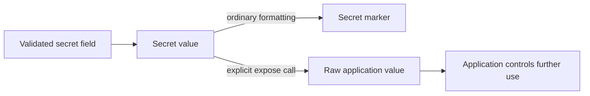

# Classify data

Classification expresses how a field should be handled at framework boundaries. It helps preserve intent when schemas are reused, but it is not whole-program tracking of every copy of a value.

Use the [logging example](../../examples/logging/README.md) to see the distinction: an email and document are personal, an API key is secret, and the handler logs schema-paired values instead of raw personal strings.

## Choose a class for a reason

| Schema                    | Handler receives     | Schema-aware log projection           | Response policy                                                     |
| ------------------------- | -------------------- | ------------------------------------- | ------------------------------------------------------------------- |
| Unclassified field        | Ordinary typed value | Declared value, within logging bounds | Allowed if declared                                                 |
| `sensitivity: 'personal'` | Ordinary typed value | `[personal]`                          | Allowed if declared; application controls who may receive it        |
| `sensitivity: 'secret'`   | `Secret<T>`          | `[secret]`                            | Refused at startup unless explicitly exposed in the response schema |

Mark the enclosing object or record when its structure or keys are themselves sensitive. Classification also coarsens validation details inside the marked field.



A `Secret` formats as `[secret]` through ordinary string conversion, JSON serialization, and inspection. `expose(secret)` deliberately returns its raw value so an application can use it—for example, to call a credential verifier. Once exposed, that raw value is no longer protected by the wrapper.

For a secret response, the response schema also needs `t.exposed(field, '<reason>')`. A deliberate token-issuing endpoint may need that capability. It should be a narrow response contract, not a reason to expose a shared account model everywhere.

## Keep the schema attached when logging

In a handler, `request.classified('body')` pairs the validated body with its route schema. `request.classified('body', 'email')` pairs one declared field. Outside a request, `classified(schema, value)` from `@skeld/core/log` serves the same purpose.

The logging example uses:

```ts
request.log.info('preview requested', {
  email: request.classified('body', 'email'),
  apiKey: request.body.apiKey,
  input: request.classified('body'),
});
```

This excerpt runs inside the [preview handler](../../examples/logging/server.ts). The email becomes `[personal]`, the wrapped API key becomes `[secret]`, and the body is projected through its schema. Undeclared object keys are not copied into that projection.

**A raw personal string still logs as a string.** Passing `request.body.email` directly as a field, or interpolating it into the message, exposes it. Personal values have no runtime wrapper. The logger bounds and escapes author strings; it cannot infer their meaning.

Plain object and array fields require classification; unclassified ones are rejected by the logger's types and become `[unclassified]` at runtime. Errors have a separate bounded reader. Classification is not an invitation to log entire application objects: prefer the smallest useful fields.

## Choose public data independently of logging policy

An email may be appropriate in an authenticated profile response and inappropriate in an operational log. Marking it personal does not prohibit the profile response or establish that its recipient is authorized.

Build a response schema with an explicit field allowlist and check the caller's rights before returning it. See [contract design](contracts.md#choose-response-fields-explicitly) and [security boundaries](../concepts/security-boundaries.md).

**Next:** run the [logging example](../../examples/logging/README.md). Reference: [Secret](../api/core/secret.md), [redact](../api/core/redact.md), and [logging limits](../logging/logging.md#limits).
