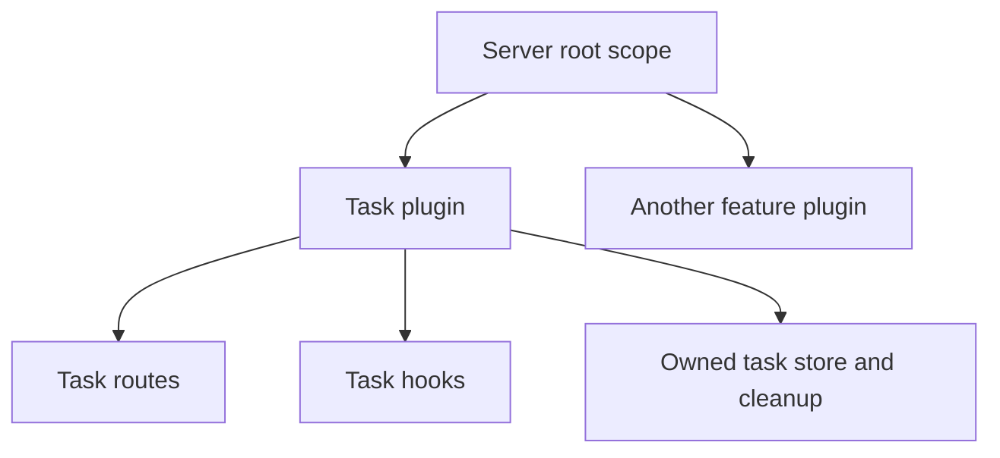

# Organize a service

Use a plugin to give a feature its own routes, hooks, and resource lifetime. Keep the contract importable on its own. The [task service](../../examples/service/README.md) shows this structure without a database or external dependency:

```text
contract.ts   public request and response shapes
tasks.ts      plugin, handlers, scoped hook, owned store
server.ts     options, registration, listening, shutdown
client.ts     calls and status handling
```

There is no requirement to split every handler into another file. Start with the feature together; extract domain operations when that makes the code easier to understand or test.

## Register before listening

`createServer()` creates the root scope. `server.register(plugin)` adds a child scope; plugins run during `listen()`. The server compiles and checks the resulting routes before accepting traffic. Registration is sealed as startup proceeds; do not add routes or cleanup callbacks from request handlers.



A child inherits its ancestor hooks. A hook on the task scope applies to its routes and descendants; it does not become a global hook for sibling features. The example's `x-example-module` header demonstrates this visibility. That header is descriptive, not an authorization check, and engine errors may clear it.

## Put work at the right lifecycle stage

| Stage        | Use it for                                                  | Constraint                                                                                    |
| ------------ | ----------------------------------------------------------- | --------------------------------------------------------------------------------------------- |
| `onRequest`  | Early checks using request metadata                         | Body and route inputs have not yet been validated                                             |
| `preHandler` | Work after validation, before the handler                   | Shared hook input types are `unknown`; they are not a particular route's inferred types       |
| Handler      | Route-specific behavior using typed inputs                  | Return a declared status and matching body                                                    |
| `onSend`     | Inspect serialized JSON and set permitted response metadata | Returning a new payload does not replace the serializer's output                              |
| `onResponse` | Observe completion                                          | Too late to change the response; connection closure is not proof the caller received the body |
| `onError`    | Observe application failures                                | Not a universal notification for engine refusals or timeouts                                  |

Hooks can terminate a request early through their supported APIs. An early raw reply is an explicit escape from the normal contract response serializer. Use it deliberately and keep private data out of it. The [request lifecycle](../concepts/request-lifecycle.md) shows the normal path and its exceptions.

## Own resources where you acquire them

Register `scope.onClose(() => resource.close())` immediately after acquisition, before another `await`. This gives failed startup a way to release resources already acquired, as well as giving normal shutdown a cleanup path.

In [tasks.ts](../../examples/service/tasks.ts), the resource is a small `Map`. Its cleanup is registered next to its creation and clears it at shutdown. The database plugin of [`@skeld/data`](data.md) does the same with its connection pool: it opens the pool, then registers the pool's close.

`scope.signal` aborts when close or failed-startup rollback begins. HTTP work drains before disposers run. Disposers run once in reverse registration order, each with its own `pluginCloseTimeoutMs` deadline, 10 seconds by default. Every registered disposer is attempted; cleanup failures or timeouts cause `close()` to reject with an `AggregateError`. Repeated calls share completion.

A cleanup that works in steps can read `scope.closeTimeoutMs`, the time it has (the server's `pluginCloseTimeoutMs`), and split it: the database plugin waits 0.4 of it for connections in use and cancels their statements for 0.1 more before closing every connection.

Cancellation is cooperative. A deadline cannot interrupt a synchronous loop or reclaim a resource acquired after a timed-out plugin continues running. Check cancellation around long initialization work and use cancellation support provided by the resource API.

## Check the final routes and write security events

A plugin that acts on other plugins' routes, such as a rate limiter, can check them before the server starts. `scope.onRoutes(callback)` is called once at `listen`, after every plugin has run and before any route is bound, with the routes the scope's hooks reach. A throw stops the boot with `PLUGIN_FAILED`. `limitRoutes` from `@skeld/data/limit` uses it to refuse a rule that names a route the server does not serve.

`scope.event(name, severity)` registers a security event, such as `data.limit.refused` at `warn`, and returns a writer that records it on the logger you pass, so a request's record carries its id. Register events while the plugin runs; a server's scopes share 64 names. The [core reference](../reference/core.md#plugin-resource-ownership) has the rules for both.

## Bound shared state as well as requests

The example allows at most 100 tasks. Limiting each title to 120 units would not stop a process from retaining millions of valid tasks.

Its capacity check and insertion are synchronous. If you move them across an `await` or into a database, enforce the capacity rule atomically there. Schema validation does not provide transaction isolation, authorization, durable storage, or a concurrency limit.

**Next:** [run a service](running-a-service.md). Reference: [Scope, hooks, and server options](../api/core/server.md).
